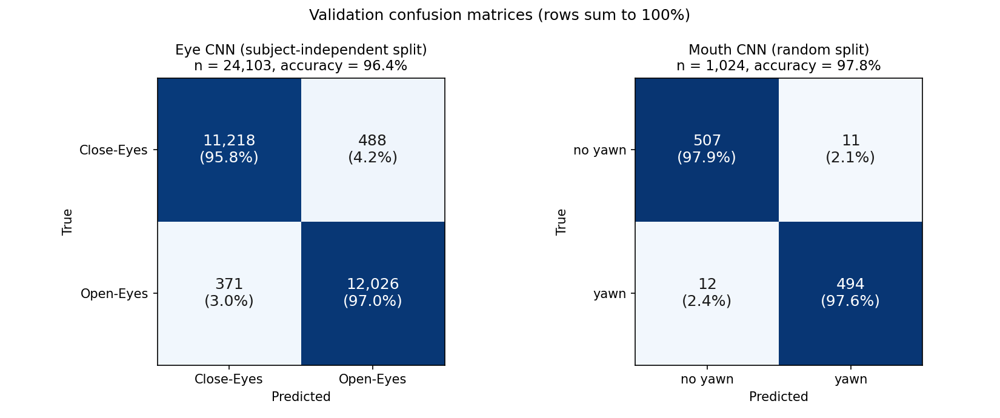
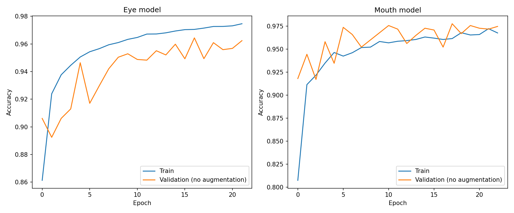

# Real-Time Driver Drowsiness Detection using YOLOv8, Haar Cascades, and CNN Classifiers

A real-time driver drowsiness detection system that combines **YOLOv8** for face detection, **Haar Cascades** for eye/mouth localization, and **lightweight CNNs** for eye-state and yawn classification. Frame-level predictions are fused over time (PERCLOS, continuous eye closure, yawn duration and count) into a single drowsiness score that drives a two-level visual/audio alert. All tests so far were done on a laptop with its built-in webcam, where the system runs in real time without a GPU. The intended product is a low-cost, **detachable camera unit** with its own small processor, which can be mounted in any car (for example older cars without a built-in driver-monitoring system); it has not been built or tested. With an NVIDIA GPU, YOLO face detection runs on the GPU through PyTorch/CUDA, while the CNNs and Haar cascades stay on the CPU (see [Device placement](#device-placement)).

**Authors:** Lam Bao Tran (1113540) and Baitikova Bermet (1113531), International Bachelor Program in Informatics (IBPI), Yuan Ze University. Revisions in November 2026 by Lam Bao Tran (see [Project history](#project-history)).

## Project history

| Version | Date | Who | What |
|---|---|---|---|
| v0 (original) | Dec 2025 | Lam Bao Tran, Baitikova Bermet | IBPI Special Project. Pipeline (YOLOv8 + Haar + CNNs + temporal fusion), webcam demo and [poster](Poster.pdf). **Honorable Mention, IBPI Special Project Exhibition, Yuan Ze University (Dec 2025).** The poster lists Prof. Naeem Ul Islam as advisor. |
| v1 (this version) | Nov 2026 | Lam Bao Tran | Re-trained both CNNs with a corrected evaluation (no augmentation on validation, subject-independent split, precision/recall/F1); smoothed mouth state; immediate microsleep alert; CPU vs GPU benchmark; webcam tests; error analysis and documented limitations. |

The poster reports the v0 numbers (86% eye / 95% mouth validation accuracy, 15.7 FPS). These were measured on augmented validation images and are superseded by the [Results](#results) below.

## Abstract

Driver fatigue is a major factor in road accidents. This project proposes a real-time, vision-based system that uses YOLOv8 for robust face detection, Haar Cascades for region localization, and lightweight CNNs for eye-state and yawn classification. The core idea is to fuse temporal evidence (eye-closure duration, PERCLOS, yawn events) into a stable, real-time drowsiness score, with smoothing, hysteresis, debouncing and a recovery mechanism to avoid flickering alerts. Prolonged eye closure (possible microsleep) raises an immediate alert, while yawning and PERCLOS act as slower early-warning signs. The project also reports what does **not** work yet: the Haar-box mouth aspect ratio turned out to carry no information, and end-to-end validation on a labelled dataset is still planned. An optional gaze-down guard (from v0, off by default) is meant to reduce false "Closed" detections when the driver looks down; it was not evaluated in v1.

## Model Architecture & Methodology

```
Input Frame (Webcam)
        │
        ▼
  YOLOv8 Face Detector  (every N frames, bbox smoothed with EMA)
        │
   ┌────┴─────┐
   ▼          ▼
Eye ROI     Mouth ROI
(upper 60%  (lower 2/3
 of face)    of face)
   │          │
Haar locate   Haar locate
(+ track /    (+ track /
 default ROI   default ROI
 fallback)     fallback)
   │          │
   ▼          ▼
 Eye CNN     Mouth CNN
 P(Open)     P(Yawn)
   │          │
 EMA +       EMA + hysteresis
 hysteresis  + gap tolerance
 + debounce  + open-duration rule
 (+ optional (+ MAR temporal features;
  gaze guard) not informative with
   │          Haar boxes, see below)
   │          │
   └────┬─────┘
        ▼
  Eye-closure duration · PERCLOS · Yawn count/duration
        │
        ▼
 Drowsiness score = max(eye, perclos, yawn)  ∈ [0, 1]
        │
        ▼
 Alert state machine (on/off hysteresis) + Recovery logic
        │
        ▼
 Driver Alert (red frame border + audio beep)
```

### Components

- **YOLOv8 face detector**: detects the driver's face. It runs every `detect_every_n_frames` (default 10) on a downscaled frame (default width 480), and the bounding box is smoothed with an EMA between detections.
- **Haar Cascades (eye / mouth)**: localize the eye and mouth within the face. They run on a downscaled grayscale image for speed. Because Haar cascades often miss closed eyes and wide-open mouths, the pipeline falls back to the **last known position** (`track`) or a **default ROI** (`default`), and lets the CNN decide. The eye Haar runs only every 3rd eye-pipeline run; in between, the tracked position is reused.
- **Eye CNN** (64×64): outputs `P(Open)`. The probability is smoothed with an asymmetric EMA (fast when closing, slow when reopening). A hysteresis maps it to a state: `P ≥ 0.70` → *Opened*, `P ≤ 0.40` → *Closed*, in between → keep the previous state. A *Closed* state must persist for 0.15 s (debounce) to be confirmed. When no valid eye ROI exists, the state is *Unknown* and is **not** counted as closed in PERCLOS.
- **Mouth CNN** (64×64): outputs `P(Yawn)`. The Haar mouth box is widened before cropping (15% margin on each side, height at least equal to width, extended downward), to bring live crops closer to the training crops: Haar mouth boxes always have h/w ≈ 0.6 (the fixed shape of the cascade's 25×15 window), while yawn images in the training set are taller than wide (h/w ≈ 1.2). The effect of this widening has not been measured on its own. MAR is still computed on the original Haar box. `P(Yawn)` is smoothed with an EMA (α = 0.4) and passed through a hysteresis (open when the EMA ≥ 0.50 and MAR ≥ 0.34; stay open until the EMA < 0.30), and short drops of up to 0.5 s do not reset the open-mouth timer. Without this, a single low-probability frame reset the timer, so a held-open mouth flickered between *Opening* and *Normal* and never reached the 1.4 s needed for *Yawn*. "MAR" here is the **height / width ratio of the Haar mouth bounding box** (not landmark-based). When Haar misses and the fallback ROI is used, MAR is not reliable, so a pseudo-MAR derived from the CNN probability is used.
- **Temporal mouth analysis** (over a 3 s window of MAR): plateau duration, zero-crossing rate (ZCR), number of peaks, area above the MAR threshold, and fraction of time above it. These were designed to separate a **yawn** (long plateau, low ZCR, large area) from **talking** (many peaks, high ZCR, short plateaus) and feed the yawn decision, not the score directly. **However, with Haar boxes MAR is almost constant (≈ 0.60), so these features do not measure mouth movement** (see [Design rationale and limitations](#design-rationale-and-limitations)). In practice, talking is filtered by the 1.4 s open-duration rule.
- **Gaze-down guard (optional, off by default, not evaluated)**: compares upper/lower brightness of the eye crop to detect looking down (e.g., at a keyboard) and suppresses a false *Closed* state, unless `P(Open)` is very low. Enable with `--use-gaze-guard`.

### Drowsiness score

Each component is normalized so that **1.0 = its alert threshold**; the score is their maximum:

| Component | Definition | Threshold (default) |
|---|---|---|
| Eye closure | continuous closed time / `eye_continuous_closed_sec` | 1.5 s |
| PERCLOS | fraction of closed time in a 60 s window / `perclos_thr` (only after a 20 s warm-up) | 0.30 |
| Yawn | `max(yawn_count / yawn_count_thr, current_yawn_duration / yawn_min_duration)` | 2 yawns in 60 s, or a yawn ≥ 1.0 s |

A raw alarm is raised when `score ≥ 1.0`.

### Alert state machine and recovery

- **Two alert levels.**
  - **Eye closure (immediate):** when the eyes stay closed for `eye_continuous_closed_sec` (1.5 s), the alert turns on **at once**. The closure duration itself already filters out normal blinks (about 0.1–0.4 s), so no extra delay is added. Euro NCAP describes microsleep as an eyelid closure of roughly 1–2 s and sleep as more than 3 s; the previous logic (1.5 s closure + 1.5 s `on_min_sec`) only alerted after about 3 s. Use `--no-microsleep-immediate` to restore the old behaviour.
  - **Yawning and PERCLOS (early signs):** the alert turns on after the score stays above the threshold for `on_min_sec` (1.5 s), which favours fewer false alarms.
- **Alert OFF** after the score stays below the threshold for `off_min_sec` (2.0 s). The reason for each alert (`eyes`, `perclos` or `yawn`) is logged and saved in the `alert_reason` column of `--save-csv`.
- **Recovery**: an active alert is cleared early when, for 3.0 s continuously, the eyes are *Opened*, the mouth is not yawning, PERCLOS < 0.15 (or warm-up not finished) and there was no yawn in the last 3.0 s. Old yawn events are cleared so the score does not immediately re-trigger.
- **Alert output**: a red border around the frame plus an audio beep (Windows `winsound`, macOS `afplay`, terminal bell on Linux, which may be silent depending on the terminal). The beep is muted while a recovery countdown is running, and can be disabled with `--no-audio`.

### Performance scheduling

To keep the pipeline real-time on CPU, work is spread across frames: YOLO every 10 frames, the eye CNN every frame, the mouth CNN every 2 frames (interleaved with the eye), the eye Haar every 3rd eye run, and frames are resized to width 640 by default. Cached results are reused in between.

## Testbed Setup

- Evaluated on an Acer laptop (Intel Core i5-12450H, NVIDIA RTX 3050 Laptop GPU) with its webcam (1280×720 @ 30 FPS, frames resized to width 640).
- YOLOv8, Haar Cascades, and both CNNs ran on CPU for the main measurement. A GPU run (`--device gpu`, RTX 3050 Laptop GPU, YOLO only on CUDA) is reported separately below.
- **Eye data:** 80,957 images (39,318 closed, 41,639 open). File names follow the [MRL Eye Dataset](http://mrl.cs.vsb.cz/eyedataset) naming (`s0001_...`, which encodes a subject ID), so the data appear to be a subset of MRL (which has 84,898 images); the exact origin was not recorded.
- **Mouth data:** 5,119 images (2,528 yawn, 2,591 no yawn), collected from public online sources (exact origin not tracked). File names carry no subject ID.
- **Evaluation protocol** (`Train.py`):
  - Validation images are **not augmented**; augmentation is applied to training images only.
  - Eye data uses a **subject-independent split** (`GroupShuffleSplit`, 20% of subjects held out): no person appears in both training and validation, so the score measures performance on **unseen people**.
  - Mouth data has no subject IDs, so it uses a stratified random 80/20 split.
  - Reported metrics: accuracy, precision, recall, F1 and confusion matrix, saved to [`results/metrics.json`](results/metrics.json).
- End-to-end FPS is measured under typical indoor lighting conditions.

> **Dataset use:** all images are used strictly for academic/educational purposes.

## Design rationale and limitations

| Part | Basis | Status |
|---|---|---|
| PERCLOS as the main drowsiness measure | FHWA Tech Brief (1998): PERCLOS was the most reliable and valid alertness measure among those tested | Approximation: the original PERCLOS (P80) is the share of time the eyes are **at least 80% closed** over one minute; here a binary open/closed CNN is used, with a 0.15 s debounce to drop most blinks |
| Eye-closure duration (microsleep) | Euro NCAP driver-monitoring guidance (microsleep ≈ 1–2 s, sleep > 3 s) | Threshold 1.5 s chosen within that range |
| Yawning as an early sign | Widely used; dedicated benchmark: YawDD | MAR here is the height/width of a Haar box, not a landmark-based ratio |
| Thresholds: PERCLOS 0.30, yawn 1.4 s, 2 yawns / 60 s, `on_min_sec` 1.5 s | Engineering choices | **Not yet validated**; to be tuned on one dataset split and tested on another |
| Score fusion `max(eye, perclos, yawn)`, talking-vs-yawn features (ZCR, plateau) | Heuristics | **Not yet validated** |
| MAR from the Haar mouth box | — | **Not informative:** a Haar cascade returns boxes with the fixed aspect ratio of its training window (25×15 for `haarcascade_mcs_mouth`), so MAR stays at ≈ 0.60 whatever the mouth does (webcam log: mean 0.599, SD 0.005; ROC AUC 0.42 for yawn vs. non-yawn frames). The MAR gate therefore never blocks, and the MAR-based talking/yawn features only reflect noise. In one webcam run, the MAR-based `yawn_like` rule still caught a real yawn that the CNN missed (P(Yawn) ≤ 0.25), most likely because the Haar box stays unusually stable while the face is still during a yawn, not because MAR measures mouth opening. Whether this helps or adds false alarms will be measured on YawDD. A landmark-based MAR is planned. |

**Main limitation:** the individual CNNs are evaluated on held-out data (see Results), but the full pipeline (detection rate, false alarms per hour, alert latency) has only been checked in short webcam tests with one person. It has not yet been evaluated against a labelled dataset such as YawDD, which contains drivers who are silent, talking/singing and yawning.

References:
- Federal Highway Administration (1998). *PERCLOS: A Valid Psychophysiological Measure of Alertness as Assessed by Psychomotor Vigilance.* Tech Brief. https://trid.trb.org/view/498744
- Optalert. *Euro NCAP's Fatigue and Unresponsive Driver Evaluation* (summary of the Euro NCAP driver-monitoring protocol, source of the microsleep and sleep durations quoted here). https://www.optalert.com/?p=1757 (Primary document, not checked line by line: Euro NCAP, *SD-202 Driver Monitoring Test Procedure v1.1*, https://www.euroncap.com/media/91719/sd-202-driver-monitoring-test-procedure-v11.pdf)
- Abtahi, S., Omidyeganeh, M., Shirmohammadi, S., & Hariri, B. (2014). YawDD: A Yawning Detection Dataset. *ACM Multimedia Systems.* Data: https://ieee-dataport.org/open-access/yawdd-yawning-detection-dataset

## Results

| Model | Split | Val. samples | Accuracy | Precision | Recall | F1 |
| --- | --- | --- | --- | --- | --- | --- |
| Eye CNN (positive = closed) | subject-independent | 24,103 | **96.4%** | 96.8% | **95.8%** | 96.3% |
| Mouth CNN (positive = yawn) | random | 1,024 | **97.8%** | 97.8% | **97.6%** | 97.7% |

Recall is reported for the class that matters most for safety: a missed closed eye or missed yawn is a missed warning.

**Confusion matrices** (rows = true class, columns = predicted):

| Eye CNN | Pred. closed | Pred. open |
| --- | --- | --- |
| True closed | 11,218 | 488 |
| True open | 371 | 12,026 |

| Mouth CNN | Pred. no yawn | Pred. yawn |
| --- | --- | --- |
| True no yawn | 507 | 11 |
| True yawn | 12 | 494 |



*Drawn from `results/metrics.json` by `plot_confusion.py`.*

**Change from the first version.** The first version reported 86% (eye) and 95% (mouth). Those numbers were measured on **augmented** validation images (random rotation, shift and zoom), and the eye split was random by image, so the same person could appear in both sets. After fixing both issues, the eye model scores 96.4% on people it has never seen, and the mouth model 97.8%.

**Caveats.**
- The eye result comes from a single subject-level split; with a small number of held-out subjects, the score can vary depending on which people are held out. A grouped k-fold cross-validation would give a more reliable estimate.
- The mouth split is random by image. If the mouth images were extracted from videos, near-identical frames of the same person may appear in both sets, so the mouth score may be optimistic.

### Webcam sanity checks (baseline v1, one participant)

These short tests on the author's webcam (CPU mode, labels entered by key press; raw logs in [`results/webcam_logs/`](results/webcam_logs/)) check that the pipeline behaves as intended. With one person and a few minutes of video, they are **not** a validation; the planned YawDD evaluation is.

| Test | Result |
|---|---|
| Uncovered yawns | 3 / 3 raised a yawn alert (alert about 4–8 s after the label started; labels were pressed slightly before the mouth opened) |
| Yawn with the hand covering the mouth from the start | Missed (P(Yawn) stayed low) |
| Yawn covered by hand after opening | Inconclusive: an alert from the previous yawn was still active |
| Talking for about 50 s | 0 false yawn alerts; the mouth reached *Opening* 4 times (≈ 0.6–1.3 s each) but never the 1.4 s needed for *Yawn* |
| Eyes closed ~2 s | Microsleep alert at 1.53 s of closure |

In these tests, talking was filtered by the 1.4 s open-duration rule, not by the MAR-based talking features (which are not informative with Haar boxes, see Design rationale).

Training curves for the current models ([`results/training_curves.png`](results/training_curves.png)). Training stopped early at epoch 22 (eye) and 23 (mouth); the best epochs were restored. The eye validation curve jumps between epochs because the validation set contains only a few people, so one person's images can move the score by several points.



**System performance:** see [FPS benchmark: CPU vs GPU](#fps-benchmark-cpu-vs-gpu) below.

### FPS benchmark: CPU vs GPU

**Why it matters.** The intended product is a detachable camera unit with its own small processor, and a processor without a GPU is much cheaper, smaller and uses less power. This benchmark, run on a laptop, measures how much speed the pipeline loses without a GPU. It does not measure a real in-car board.

**Hardware:** Acer laptop, Intel Core i5-12450H (8 cores: 4 performance + 4 efficiency, 12 threads), NVIDIA GeForce RTX 3050 Laptop GPU (4 GB), webcam 1280×720 @ 30 FPS, frames resized to width 640. Software: TensorFlow 2.15.1, PyTorch 2.2.1+cu121, Ultralytics 8.3.0, OpenCV 4.11.0.

**Protocol.** Each mode runs for 70 s with the same person, lighting and seating, plugged into power, with no other heavy programs open. Every processed frame is logged with its timestamp (`--save-csv`), and `fps_report.py` drops the first 10 s (model warm-up) before computing statistics:

```
python main.py --device cpu --duration 70 --no-audio --save-csv fps_cpu.csv
python main.py --device gpu --duration 70 --no-audio --save-csv fps_gpu.csv
python fps_report.py fps_cpu.csv fps_gpu.csv --md
```

| Mode | What runs on the GPU | Mean FPS | Median FPS (1-s bins) | Min FPS (1-s bins) | 95th pct frame time (ms) |
|---|---|---|---|---|---|
| `--device cpu` | nothing | **20.4** | 20 | 17 | 96 |
| `--device gpu` | YOLOv8 face detector only | **26.0** | 26 | 21 | 58 |

Measured on 2026-11-03, 60 s per mode after a 10 s warm-up (1,221 and 1,552 frames). The participant yawned during the runs; this changes the per-frame work very little, but a still-face run would be cleaner. Moving YOLO to the GPU raises the mean FPS by about **27%** and lowers the 95th-percentile frame time from 96 ms to 58 ms (smoother video). The CPU-only mode stays real-time at about 20 FPS **on this laptop CPU**, which makes a GPU-free design worth pursuing; whether a low-cost device keeps up has to be measured on that device. The gain is limited because YOLO runs only on every 10th frame, while the CNNs and Haar cascades stay on the CPU in both modes.

Notes:
- The webcam delivers at most 30 FPS, so 30 FPS is the upper bound for both modes.
- A laptop i5-12450H is much faster than the CPUs in low-cost embedded boards, so CPU-only results here are an upper bound; the target device must be measured directly.
- In GPU mode only YOLO moves to the GPU (see [Device placement](#device-placement)); the CNNs and Haar cascades stay on the CPU.
- FPS drops when the face is lost (YOLO then runs on every frame instead of every 10th) or when Haar misses the mouth (an extra CLAHE pass). The protocol keeps the face in view to measure the normal case. FPS depends on the scheduling options (`--detect-interval`, `--eye-every`, `--mouth-every`, `--eye-haar-every`, `--width`) and on the chosen device.

> **Limitations:** see [Design rationale and limitations](#design-rationale-and-limitations). In short: no end-to-end evaluation on a labelled dataset yet; Haar-based MAR is not informative; the mouth CNN drops on live webcam frames (frame-level ROC AUC ≈ 0.69 in one labelled webcam session, versus 97.8% accuracy on its validation set) and does not see yawns covered by a hand; the gaze-down guard was not evaluated; all live tests used a laptop webcam indoors, not a camera mounted in a car.

## Conclusion

- The system combines a modern detector (YOLOv8) with efficient classical components (Haar Cascades) and lightweight CNNs, plus temporal modeling.
- On a laptop with its built-in webcam (Intel i5-12450H, a high-performance mobile chip) it runs in real time without a GPU (20.4 FPS); moving YOLO to the GPU adds about 27% (26.0 FPS). This shows the GPU is not essential **on this laptop**, but it does not yet show that a low-cost device is fast enough: embedded CPUs are several times slower, and that must be measured on the target hardware.
- On un-augmented validation data, the eye-state CNN reaches 96.4% accuracy (95.8% recall for closed eyes) on unseen subjects, and the yawn CNN 97.8% accuracy (97.6% recall).
- Temporal smoothing and hysteresis make the alert more stable than frame-by-frame predictions; adding them to the mouth pipeline was what made yawn detection work at all on the webcam.
- Prolonged eye closure now triggers an alert at 1.5 s instead of about 3 s.
- Error analysis showed that the Haar-box MAR is constant by construction and that the mouth CNN degrades on live frames. These findings motivate the next step below.

## Next steps

1. **End-to-end evaluation on YawDD**: run the full pipeline on all clips (requires adding and testing video-file input), tune thresholds on one group of drivers and test on the others; report yawn recall, false alarms while talking, and alert latency.
2. **Ablation on a CPU-only budget**: compare (a) the mouth CNN, (b) a landmark-based MAR (e.g. MediaPipe Face Mesh), and (c) both combined, on detection quality and CPU FPS. Research question: *is the CNN worth its compute cost on a low-cost device compared with simple landmark geometry?*
3. **Grouped k-fold cross-validation** for the eye CNN, to report mean ± spread instead of a single split.
4. **Build and test a detachable camera unit**: a camera module on a low-cost processing board (e.g. a Raspberry Pi-class board), mounted in a car. This changes three things at once:
   - **Processor:** much slower than the laptop CPU, so FPS must be measured again.
   - **Mounting:** a detachable unit is placed slightly differently each time, so the system must cope with different camera angles and distances.
   - **Camera:** different angle, sunlight and night driving (which needs an infrared camera). The eye training images (MRL) were captured with infrared cameras, while all webcam tests used a colour webcam, which may be one reason the models do worse on live frames.

## Project Structure

```
.
├── datasets/             # Training image datasets (not pushed to GitHub, see .gitignore)
│   ├── eyes/
│   │   ├── Close-Eyes/
│   │   └── Open-Eyes/
│   └── mouth/
│       ├── no yawn/
│       └── yawn/
├── Models/               # Trained models (not pushed to GitHub, see .gitignore)
│   ├── eye_detector.h5
│   ├── mouth_detector.h5
│   ├── yolov8-face.pt
│   ├── haarcascade_eye.xml
│   └── haarcascade_mcs_mouth.xml
├── TrainModel Pic/       # Charts from the FIRST version (augmented validation); current curves are in results/
│   ├── Figure_1.png
│   ├── Figure_2.png
│   └── Figure_TrainModel.png
├── Poster.pdf            # v0 poster (Dec 2025); its numbers are superseded by this README
├── main.py               # Runs real-time drowsiness detection via webcam
├── Train.py              # Trains the eye and mouth CNN models
├── fps_report.py         # FPS statistics from main.py --save-csv logs
├── analyze_yawn.py       # Yawn detection analysis from labelled --save-csv logs
├── test_mouth.py         # Checks the mouth CNN on dataset images (RGB vs BGR input)
├── plot_confusion.py     # Draws results/confusion_matrices.png from results/metrics.json
├── results/              # metrics.json, training curves and confusion matrices
│   └── webcam_logs/      # raw per-frame CSV logs behind the FPS table and webcam sanity checks
├── requirements.txt
└── README.md
```

> Note: the `datasets/` and `Models/` folders are **not** included in this repo (see `.gitignore`) due to their large size. The `TrainModel Pic/` folder is kept since the images are small.

## Installation

```
git clone https://github.com/Baaotraan0407/drowsiness-detection.git
cd drowsiness-detection
pip install -r requirements.txt
```

Main dependencies: OpenCV, TensorFlow/Keras, PyTorch + Ultralytics (YOLOv8), NumPy, scikit-learn, pandas. Tested only on Windows with TensorFlow 2.15.1, PyTorch 2.2.1+cu121, Ultralytics 8.3.0 and OpenCV 4.11.0. For GPU use, install a CUDA-enabled build of PyTorch (YOLO).

## Models & Dataset

The following files are required inside the `Models/` folder (not included in this repo):

- `yolov8-face.pt`: YOLOv8 face detection model
- `eye_detector.h5`: CNN for eye-state classification, 64×64 input, output = `P(Open)` (trained via `Train.py`)
- `mouth_detector.h5`: CNN for yawn classification, 64×64 input, output = `P(Yawn)` (trained via `Train.py`)
- `haarcascade_eye.xml`, `haarcascade_mcs_mouth.xml`: OpenCV Haar Cascade classifiers

The model folder is resolved in this order:

1. `--model-dir <path>` (command line)
2. the `MODEL_DIR` environment variable
3. `./Models`, then `./models` (current directory)

```
# Windows (PowerShell)
$env:MODEL_DIR="D:\path\to\Models"

# Windows (cmd)
set MODEL_DIR=D:\path\to\Models

# macOS / Linux
export MODEL_DIR=/path/to/Models
```

### Training (optional)

To retrain the eye/mouth models, prepare the dataset with this structure:

```
datasets/
├── eyes/
│   ├── Close-Eyes/
│   └── Open-Eyes/
└── mouth/
    ├── no yawn/
    └── yawn/
```

Then run:

```
python Train.py
```

The best-performing models are saved by `Train.py`; copy them into your model folder as `eye_detector.h5` and `mouth_detector.h5`.

## Usage

```
python main.py                  # asks you to choose GPU (1) or CPU (2)
python main.py --device cpu     # skip the prompt, force CPU
python main.py --device gpu     # use GPU if available (falls back to CPU with a warning)
```

- Press **q** to quit.
- Press **y** when a yawn starts and **y** again when it ends to label it; the label is saved in the `gt_yawn` column of `--save-csv` and used by `analyze_yawn.py`.
- The window shows: face bounding box, eye state (with `P(Open)`, EMA and ROI source), mouth state (with open duration, MAR, `P(Yawn)` and temporal features), PERCLOS, yawns in the last 60 s, status (AWAKE / DROWSY) with score, FPS and the YOLO device. A red border appears when DROWSY.
- With `--device cpu`, TensorFlow is also forced onto the CPU. With `--device gpu`, YOLO uses `cuda:0` if available, and TensorFlow uses whatever GPU its build supports (none on native Windows, see below).

### Device placement

The pipeline uses three libraries, and each decides on its own whether it can use the GPU. The startup log prints the result, for example:

```
Device (PyTorch - YOLO face):        GPU (NVIDIA GeForce RTX 3050 Laptop GPU)
Device (TensorFlow - eye/mouth CNN): CPU
Haar cascades (OpenCV):              CPU
```

| Component | Library | GPU? |
|---|---|---|
| YOLOv8 face detector | PyTorch | Yes, with a CUDA build of PyTorch (e.g. `torch 2.2.1+cu121`) |
| Eye / mouth CNNs | TensorFlow | Not on native Windows: TensorFlow 2.11+ has no Windows GPU build (use WSL2 for GPU) |
| Haar cascades | OpenCV (pip) | No: the pip build of OpenCV has no CUDA support |

This split is reasonable: YOLO is the heaviest model, while the 64×64 CNNs and Haar cascades are already fast on CPU.

### Command-line options

| Option | Description |
|---|---|
| `--model-dir` | Folder containing the models |
| `--camera` | Camera index (default 0) |
| `--width` | Resize frame width (default 640, 0 = keep original) |
| `--device {gpu,cpu}` | Skip the device prompt |
| `--no-audio` | Disable the audio alert |
| `--duration S` | Stop automatically after S seconds (for timed benchmarks) |
| `--no-microsleep-immediate` | Disable the immediate eye-closure alert (old behaviour) |
| `--save-csv PATH` | Log time series (PERCLOS, eye/mouth state and probabilities, score, status) to CSV |
| `--log-level` | DEBUG / INFO / WARNING / ERROR |
| `--detect-interval N` | Run YOLO every N frames |
| `--yolo-downscale W` | Downscale width for YOLO (0 = off) |
| `--yolo-conf`, `--yolo-iou` | YOLO confidence / NMS IoU thresholds |
| `--eye-every N`, `--mouth-every N` | Run the eye / mouth pipeline every N frames |
| `--eye-haar-every N` | Run the eye Haar every N eye-pipeline runs |
| `--eye-open-prob-thr`, `--eye-closed-prob-thr` | Eye hysteresis thresholds (0.70 / 0.40) |
| `--eye-closed-debounce S` | Seconds a closed eye must persist (0.15) |
| `--eye-min-neighbors`, `--eye-clahe` | Eye Haar tuning / CLAHE fallback (slower) |
| `--no-eye-roi-fallback`, `--no-mouth-roi-fallback` | Disable fallback ROI when Haar misses (miss → Unknown for the eye) |
| `--use-gaze-guard` | Enable the gaze-down guard (not evaluated) |
| `--gaze-down-ratio`, `--gaze-min-delta`, `--gaze-min-bright`, `--gaze-guard-override` | Gaze guard tuning |
| `--recovery-duration`, `--recovery-perclos`, `--recovery-yawn-cooldown` | Recovery settings (3.0 s / 0.15 / 3.0 s) |

Debug / model-compatibility options:

| Option | Description |
|---|---|
| `--show-eye-crop`, `--show-mouth-crop` | Show the crop fed to each CNN |
| `--eye-invert` | Use if the eye model outputs `P(Closed)` instead of `P(Open)` |
| `--eye-bgr`, `--mouth-bgr` | Feed BGR crops to the CNN. By default crops are converted BGR → RGB, matching how Keras loaded the training images (`--eye-rgb` / `--mouth-rgb` are kept for compatibility and are now the default) |
| `--mouth-crop-pad`, `--mouth-crop-aspect` | Margin around the Haar mouth box (default 0.15) and minimum crop height/width ratio (default 1.0) |
| `--mouth-prob-thr` | `P(Yawn)` threshold for an open mouth / yawn (default 0.50) |
| `--mar-thr` | MAR threshold for an open mouth (default 0.34; lower = a smaller opening counts as open) |
| `--mouth-off-prob-thr`, `--mouth-gap` | Mouth hysteresis release threshold (default 0.30) and gap tolerance in seconds (default 0.5) |
| `--gray-eye`, `--gray-mouth` | Feed grayscale crops to the CNN |

> `--yolo-device` exists but is currently overridden by the GPU/CPU choice (`--device` or the prompt).

## Tech Stack

- Python
- OpenCV
- Ultralytics YOLOv8 / PyTorch
- TensorFlow / Keras
- NumPy, Matplotlib (training plots)